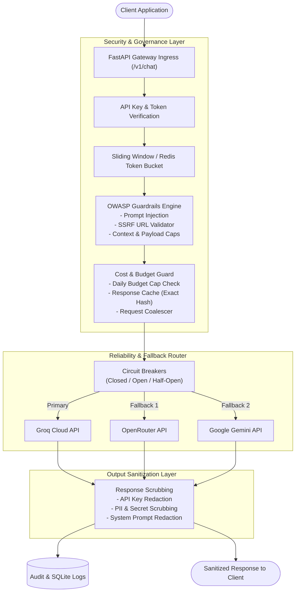

# LLM Gateway

[](https://fastapi.tiangolo.com)
[](https://www.python.org/)
[](https://opensource.org/licenses/MIT)
[](https://owasp.org/www-project-top-10-for-large-language-model-applications/)

An enterprise-grade, high-performance LLM Gateway and reverse proxy built on **FastAPI**. It delivers unified multi-provider model routing, automated failovers with circuit breakers, cost and daily budget governance, OWASP Top 10 security guardrails, rate limiting, an asynchronous job queue with Dead Letter Queue (DLQ) replay, and a real-time observability dashboard.

---

## 🏛️ High-Level Architecture



---

## ✨ Core Capabilities

### 1. Multi-Provider Fallback & Resiliency
- **Automated Failover Chains:** Seamless fallback across **Groq**, **OpenRouter**, and **Google Gemini** when an upstream provider experiences rate limits (HTTP 429), server errors (5xx), or network timeouts.
- **Adaptive Circuit Breakers:** Independent state tracking (`CLOSED`, `OPEN`, `HALF_OPEN`) per provider node with error threshold trip counters, reset timeouts, and exponential backoff with jitter.
- **Chaos Injection:** Endpoints to test and simulate provider failures and verify failover behavior under load.

### 2. OWASP Top 10 for LLMs Security Wall
- **LLM01 - Prompt Injection & Jailbreaks:** Pre-execution regex and semantic scanning (`INJECTION_PATTERNS`) blocking prompt overrides and DAN-style payloads.
- **LLM02 & LLM05 - Secret & Sensitive Data Disclosure:** Real-time output scanning redacting API keys, AWS/GCP tokens, SSNs, credit cards, and running environment variables before response delivery.
- **LLM06 - SSRF Prevention:** URL scheme and IP address validator blocking private RFC 1918 subnets, loopbacks, and cloud instance metadata (`169.254.169.254`).
- **LLM07 - System Prompt Protection:** Redacts confidential system directives configured in `models.json` if reflected or coerced in completion outputs.
- **LLM10 - Unbounded Consumption:** Strict 1MB payload limits, token context thresholds, and fail-safe local token-bucket rate limiting that remains active during Redis outages.

### 3. Cost Governance, Caching & Coalescing
- **Per-Token Cost Calculation:** Accurate calculation of prompt and completion token costs based on pricing definitions in `models.json`.
- **Daily Budget Caps:** Per-key hard budget caps with automated cutoff (HTTP 429) to prevent runaway billing.
- **Response Caching:** In-memory and Redis-backed response caching for idempotent queries.
- **In-Flight Request Coalescing:** Deduplicates identical concurrent requests to prevent duplicate upstream LLM invocations.

### 4. Asynchronous Jobs & Dead Letter Queue (DLQ)
- Enqueue long-running generative tasks via `/v1/jobs` for background execution.
- Dead Letter Queue (`/v1/dlq`) retains permanently failed jobs with full failure diagnostics and a one-click `/replay` endpoint.

### 5. Live Observability & Visualizer Dashboard
- Real-time Server-Sent Events (SSE) traffic stream via `/api/reliability/traffic-stream`.
- Visualizer dashboard at `/visualize` displaying active routes, circuit breaker node health, live latencies, and token expenditures.

---

## 📂 Repository Structure

```text
.
├── app/
│   ├── main.py            # Primary FastAPI app, reverse proxy, SSE traffic stream & UI routes
│   ├── reliability.py     # Circuit breakers, upstream provider clients, fallbacks & health checks
│   ├── security.py        # Gateway API keys, sliding-window rate limiters, token verification
│   ├── guardrails.py      # OWASP prompt injection scanner, secret redaction, SSRF inspection
│   ├── cost.py            # Token pricing, budget limits, response cache, request coalescer
│   ├── jobs.py            # Background job management, async task worker & Dead Letter Queue (DLQ)
│   └── auth.py            # User authentication, Google OAuth 2.0 flow & session handlers
├── components/            # UI components and voice-orb visualization primitives
├── docs/
│   └── security-findings.md # Comprehensive OWASP security audit matrix and remediation details
├── scripts/
│   ├── benchmark_100_requests.py   # Concurrency benchmark script
│   ├── load_test_concurrency.py    # Multi-worker stress tester
│   └── proof_dlq_replay.py         # Automated verification for DLQ failover and replay
├── tests/
│   ├── test_owasp_guardrails.py    # OWASP Top 10 security regression tests
│   ├── test_reliability.py         # Circuit breaker and fallback verification
│   ├── test_async_jobs.py          # Job queue & DLQ test suite
│   └── test_concurrency_mocked.py  # Concurrency & request coalescing tests
├── models.json            # Model catalog, context windows, and token pricing matrix
├── requirements.txt       # Production & test Python dependencies
├── .env.example           # Environment variable template
└── .gitignore             # Git exclusion rules (safeguarding keys, DBs, and scratch scripts)
```

---

## 🚀 Quick Start

### 1. Prerequisites
- **Python:** 3.10 or higher
- **Optional:** Redis instance (for distributed caching; falls back to in-memory automatically)

### 2. Installation

```bash
# Clone the repository
git clone https://github.com/Tushar01yadav/LLM-Gateway.git
cd "LLM-Gateway"

# Create and activate a virtual environment
python -m venv venv

# Windows (PowerShell):
.\venv\Scripts\Activate.ps1
# Linux / macOS:
source venv/bin/activate

# Install required packages
pip install -r requirements.txt
```

### 3. Configure Environment Variables

Copy the provided template and add your upstream API keys:

```bash
cp .env.example .env
```

Edit `.env`:
```ini
# Upstream Providers
GROQ_API_KEY=gsk_your_groq_api_key
OPENROUTER_API_KEY=sk-or-your_openrouter_key
GEMINI_API_KEY=your_gemini_key

# Gateway Admin Token
ADMIN_SECRET_KEY=your_secure_admin_key
GATEWAY_ADMIN_TOKEN=your_admin_bearer_token

# Optional: Redis (leave empty or set custom URL)
REDIS_URL=redis://127.0.0.1:6379/0
```

### 4. Run the Server

```bash
uvicorn app.main:app --host 0.0.0.0 --port 8000 --reload
```

- **Interactive Swagger Documentation:** [http://localhost:8000/docs](http://localhost:8000/docs)
- **Live Visualizer & Admin Dashboard:** [http://localhost:8000/visualize](http://localhost:8000/visualize)
- **Health Check:** [http://localhost:8000/health](http://localhost:8000/health)

---

## 📡 Key API Endpoints

### Chat Completion (Reverse Proxy)
```http
POST /v1/chat
Content-Type: application/json
Authorization: Bearer <GATEWAY_API_KEY>

{
  "model": "llama-3.3-70b-versatile",
  "messages": [
    {"role": "user", "content": "Explain circuit breaker pattern in distributed systems."}
  ],
  "temperature": 0.7
}
```

### Async Job Processing & DLQ
| Method | Endpoint | Description |
| :--- | :--- | :--- |
| `POST` | `/v1/jobs` | Submit a long-running generation job for asynchronous background processing |
| `GET` | `/v1/jobs/{job_id}` | Poll execution status and retrieve completion result |
| `GET` | `/v1/dlq` | List all failed jobs routed to the Dead Letter Queue |
| `POST` | `/v1/dlq/{job_id}/replay` | Replay a failed job after upstream service recovery |

### Reliability & Circuit Breaker Control
| Method | Endpoint | Description |
| :--- | :--- | :--- |
| `GET` | `/api/reliability/status` | Current circuit breaker status and error counts per provider node |
| `POST` | `/api/reliability/circuit-breaker/trip` | Manually trip a provider circuit breaker (for chaos testing) |
| `POST` | `/api/reliability/circuit-breaker/reset` | Manually reset a tripped circuit breaker to `CLOSED` |
| `GET` | `/api/reliability/traffic-stream` | Server-Sent Events (SSE) stream of real-time requests and latencies |

### Gateway Security & Key Management
| Method | Endpoint | Description |
| :--- | :--- | :--- |
| `POST` | `/api/gateway-keys` | Generate a new gateway API key with custom RPM quota and daily budget |
| `GET` | `/api/gateway-keys` | List active keys, cumulative spends, and rate limits |
| `DELETE`| `/api/gateway-keys/{key_id}` | Revoke an existing API key immediately |
| `GET` | `/api/audit-logs` | Retrieve audit events (pre-sanitized with secret redaction) |

---

## 🧪 Testing & Verification

Run the complete test suite:
```bash
pytest tests/ -v
```

Run specific test modules:
```bash
# Verify OWASP Top 10 Guardrails
pytest tests/test_owasp_guardrails.py -v

# Verify Circuit Breakers and Fallbacks
pytest tests/test_reliability_mocked.py -v

# Verify Async Job Queue and DLQ Replay
pytest tests/test_async_jobs.py -v
```

Execute load and stress testing scripts:
```bash
python scripts/benchmark_100_requests.py
python scripts/load_test_concurrency.py
```

---

## 🤖 AI Ingestion & Analysis Guide

When sharing this repository with AI coding assistants (ChatGPT, Claude, Cursor):
- **Avoid pasting raw GitHub web URLs in chat:** Web scrapers only fetch the landing page HTML and cannot crawl subfolders or inspect source files.
- **Claude Projects:** Connect this repository directly via Claude's GitHub integration for full-codebase search and context indexing.
- **Gitingest / Repomix:** Use [Gitingest](https://gitingest.com) by prefixing `gitingest.com/Tushar01yadav/LLM-Gateway` or run `npx repomix` to bundle clean, token-efficient source context.
- **Excluded Files:** `.gitignore` automatically excludes `scratch/`, test image artifacts, and binary `.db` files to keep prompt context clean.

---

## 📄 License

This project is licensed under the [MIT License](LICENSE).
