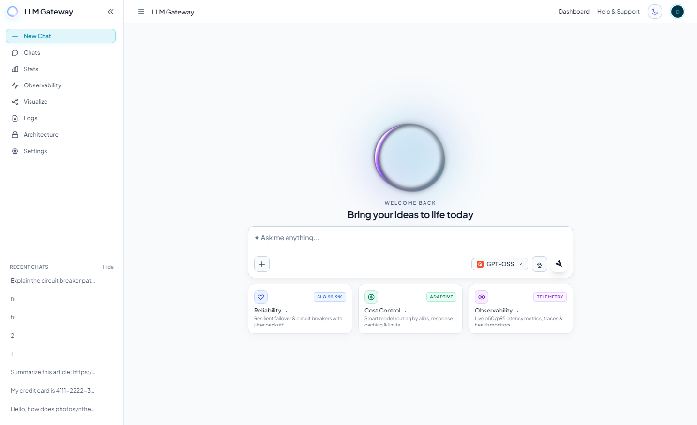
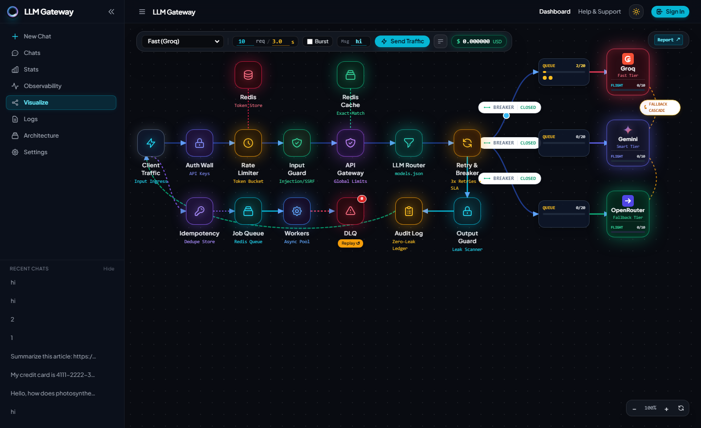
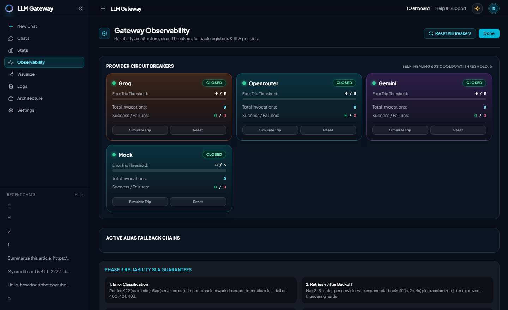
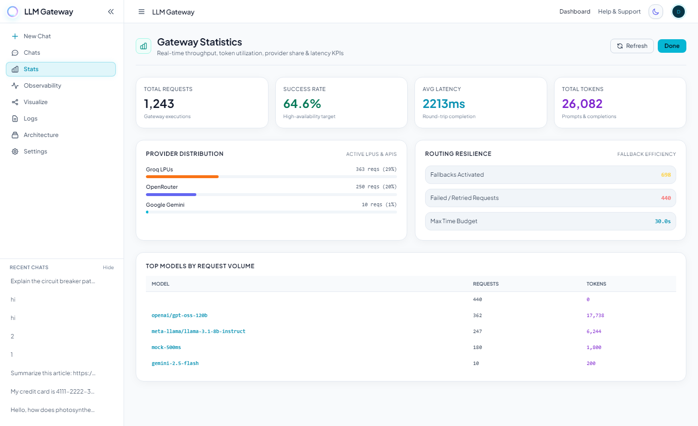

# LLM Gateway

[](https://github.com/Tushar01yadav/LLM-Gateway/actions/workflows/ci.yml)

LLM Gateway routes chat requests to configured providers through one API. It includes retries and ordered fallback, per-provider circuit breakers and concurrency limits, heuristic guardrails, budget controls, async jobs with a dead-letter queue, and an SSE-backed visualizer. Verified behavior and known limits are listed in [CLAIMS.md](CLAIMS.md).

**60-second demo:** [docs/demo.md](docs/demo.md).

Multi-process PostgreSQL/Redis verification topology, guarantees, and limitations: [docs/multi-instance-reliability.md](docs/multi-instance-reliability.md).

---

## Architecture

```mermaid
flowchart LR
    Client["Client apps"]

    subgraph GW["LLM Gateway (FastAPI)"]
        direction TB
        V["Validate input & alias"]
        SEC["Security & Auth<br/>Per-key rate limiting"]
        GR["Heuristic Guardrails<br/>Injection, secrets, PII flags"]
        CG["Cost Guard<br/>Budget & cache check"]
        GL["Global limit<br/>load shedding"]
        R["Router<br/>models.json registry"]
        
        subgraph REL["Reliability layer"]
            direction TB
            RT["Retries + jitter backoff"]
            FB["Ordered fallback chains"]
            CB["Circuit breakers"]
        end
        
        subgraph CON["Concurrency control"]
            direction TB
            SEM["Per-provider semaphores"]
            Q["Bounded queues"]
        end
        
        AD["Provider adapters"]
        SAN["Response sanitization<br/>Secret & prompt scrub"]
        LOG[("Audit & request logs")]
        EV["SSE event stream"]
    end

    Client --> V --> SEC --> GR --> CG --> GL --> R --> REL --> CON --> AD
    AD --> GROQ["Groq Cloud"]
    AD --> OR["OpenRouter"]
    AD --> GEM["Google Gemini"]
    AD --> SAN --> LOG
    LOG --> EV --> VIZ["Live Visualizer (/visualize)"]

    JOBS["Async jobs + DLQ (/v1/jobs)"] -.-> CON
```



---

## 📸 Interface Showcase

### 1. Unified LLM Chat Interface
The interface includes model selection. Provider-specific behavior and known limits are documented in [CLAIMS.md](CLAIMS.md):



---

### 2. Live Observability & Traffic Visualizer
The built-in **Interactive Topology Visualizer** (`/visualize`) provides real-time tracking of request lifecycles:
- **Request Node Traveling:** Watch request nodes travel dynamically across cables in real time—entering at **Client Ingress**, passing through **Auth**, **Rate Limiter**, **Heuristic Input Guard**, and **Cache**, through the **Router** to upstream provider nodes.
- **Simulating Traffic:** Built-in controls support individual requests and steady streams. Burst controls are present, but their 50–100+ simultaneous-request capacity has not been verified.
- **Safety & Resiliency in Action:** Visually observe how the gateway isolates load: semaphores queue in-flight requests, bulkheads shed excess load (`429 + Retry-After`), and circuit breakers automatically switch from `CLOSED` to `OPEN` to reroute traffic down the fallback cascade.



---

### 3. Circuit Breakers & Observability Dashboard
Inspect provider node health, error trip counters, recovery cooldown timers, and active fallback strategies with real-time status beacons:



---

### 4. Real-Time Telemetry & Statistics
Monitor request throughput, high-availability targets, round-trip latency (P50/P95/P99), token consumption, and provider distribution breakdown:



---

## Why This Exists

Applications that invoke upstream LLM providers directly encounter predictable systemic vulnerabilities:

| Problem | Without a Gateway | With this Gateway |
|---|---|---|
| **Provider outage or rate limit (429)** | The client app crashes | Retries with jitter, then automatically fails over to the next provider |
| **Traffic spikes & runaway concurrency** | Memory spikes, 429 storms, server failure | Semaphores, bounded queues, and load shedding with `429 + Retry-After` |
| **Failing provider degradation** | Repeatedly hammered by failing requests | Circuit breaker trips to `OPEN`, skipping failing nodes until health probes pass |
| **Prompt injection & system prompt leaks** | Vulnerable to DAN exploits & directive theft | Pre-execution regex inspection & automated post-execution secret redaction |
| **Runaway API token costs** | Unexpected cloud bills | Per-key daily budget caps, token costing, response cache & request coalescing |
| **Switching models or providers** | Code rewrite and redeployment | Change a single alias configuration line in `models.json` |
| **Unobservability ("Why is it slow?")** | Blind debugging across distributed APIs | Per-request latency breakdown and real-time SSE traffic visualizer |
| **Secret management** | API keys distributed across services | Provider keys isolated entirely within the gateway |

---

## Current Status & Feature Matrix

| Area | Feature | State | Implementation Details |
|---|---|---|---|
| **Core Proxy** | Unified chat completion API (`/v1/chat`), request validation, latency & token logging | **Built** | `app/main.py` |
| **Routing** | Intent alias routing (`fast`, `smart`, `cheap`) driven by `models.json` | **Built** | `models.json`, `app/reliability.py` |
| **Providers** | Native client adapters for **Groq**, **OpenRouter**, and **Google Gemini** | **Built** | `app/reliability.py` |
| **Reliability** | Error classification, exponential backoff with jitter, ordered fallback chains | **Built** | `app/reliability.py` |
| **Reliability** | Per-provider circuit breakers (`CLOSED`, `OPEN`, `HALF_OPEN`) | **Built** | `app/reliability.py` |
| **Concurrency** | Global & per-provider bulkheads, bounded queues, load shedding (`429 + Retry-After`) | **Built** | `app/reliability.py` |
| **Security** | Gateway API keys, admin verification, sliding-window token bucket (Redis + memory fallback) | **Built** | `app/security.py` |
| **Guardrails (heuristic)** | Prompt-injection pattern scan (NFKC/zero-width/control-normalized), SSRF private-IP blocker, hard-secret redaction, PII flagging without silent rewriting, system-prompt masking | **Built** | `app/guardrails.py`, `docs/security-findings.md` |
| **Cost & Budget** | Per-model token calculation, daily budget caps, response caching, request coalescing | **Built** | `app/cost.py` |
| **Async Jobs** | Database-backed leases and reconciliation, tenant-scoped idempotency, retries and DLQ replay | **Built** | `app/jobs.py`, `docs/async-jobs.md` |
| **Observability** | Live visualizer dashboard and real-time Server-Sent Events (`/api/reliability/traffic-stream`) | **Built** | `app/main.py`, `/visualize` |
| **Observability** | Prometheus HTTP metrics export & provisioned Grafana dashboard | **Built** | `/metrics`, `observability/` |
| **Observability** | OpenTelemetry distributed tracing | Planned | Next iteration |

### Guardrail scope (heuristic baseline)

The guardrails are a **heuristic baseline**, not a boundary that stops every prompt injection. They are deterministic pattern/heuristic scans with a bounded normalization step (NFKC, zero-width/control stripping, case-folding). Known bypass classes that still pass:

- Cross-script homoglyphs (e.g. Cyrillic `і` inside "ignore")
- Letter-spaced or token-obfuscated instructions ("i g n o r e ...")
- Encoded payloads (base64, rot13) that the model decodes
- Paraphrases outside the fixed pattern set
- Multi-turn or indirect injection carried through retrieved content

Hard secrets (API keys, SSN, cards, JWTs, private keys) are redacted. Personal identifiers (email, phone) are **flagged in audit records and left untouched** — they are never silently rewritten. Treat this as one defensive layer, not the only one.

---

## Request Flow


### Request Outcomes

| What happens | What the gateway does | Client sees |
|---|---|---|
| **Healthy path** | Validate, authenticate, check budget, call provider, sanitize output | `200 OK` |
| **Oversized payload or invalid input** | Reject before invoking any provider | `400` or `413 Payload Too Large` |
| **Rate limit exceeded** | Reject via token-bucket limiter (works even if Redis is offline) | `429 Too Many Requests` |
| **Prompt injection / SSRF detected** | Guardrail engine blocks input | `400 Bad Request (Blocked)` |
| **Gateway / Provider saturated** | Shed request via semaphore queue check | `429 + Retry-After` |
| **Breaker open for a provider** | Skip degraded node instantly, attempt next fallback in chain | `200 OK` via fallback |
| **Provider failure (429, 5xx, timeout)**| Retry with jitter, record error on breaker, fallback to next node | `200 OK` via fallback |
| **Client error (400, 401, 403)** | Do not retry, do not trip breaker, fallback to next provider | `200 OK` via fallback |
| **Entire chain exhausted** | Return service error | `502 Bad Gateway` or `504 Gateway Timeout` |

---

## Quick Start

### 1. Installation

```bash
# Clone the repository
git clone git@github.com:Tushar01yadav/LLM-Gateway.git
cd "LLM-Gateway"

# Create and activate virtual environment
python -m venv .venv

# Windows (PowerShell):
.\.venv\Scripts\Activate.ps1
# Linux / macOS:
source .venv/bin/activate

# Install dependencies
pip install -r requirements.txt
```

### 2. Environment Configuration

Copy the sample environment file and provide your provider credentials:

```bash
cp .env.example .env
```

Key `.env` parameters:
```ini
GROQ_API_KEY=gsk_your_groq_api_key
OPENROUTER_API_KEY=sk-or-your_openrouter_key
GEMINI_API_KEY=your_gemini_key
GATEWAY_ADMIN_TOKEN=your_secure_admin_token
TRUSTED_PROXY_COUNT=0
RATE_LIMIT_FAIL_MODE=closed
```

### 3. Running the Gateway

```bash
uvicorn app.main:app --host 0.0.0.0 --port 8000 --reload --no-proxy-headers
```

Production start command (no reload, one process per worker; Redis shared):

```bash
APP_ENV=production \
TRUSTED_PROXY_COUNT=1 \
GATEWAY_ADMIN_TOKEN="$(cat /run/secrets/gateway_admin_token)" \
REDIS_URL=redis://redis:6379/0 \
uvicorn app.main:app --host 0.0.0.0 --port 8000 --no-proxy-headers --workers 2
```

At startup the app validates the deploy configuration and refuses to start in
production when `TRUSTED_PROXY_COUNT > 0` but uvicorn proxy headers are not
provably disabled (`--no-proxy-headers`, or `GATEWAY_PROXY_HEADERS_DISABLED=1`
for non-CLI launchers such as gunicorn). With `APP_ENV=production` and
`TRUSTED_PROXY_COUNT=0` it logs a warning: if a reverse proxy is in front,
per-IP limits would otherwise all bucket on the proxy address.

> **Proxy headers:** always run uvicorn with `--no-proxy-headers`. Uvicorn's
> default middleware rewrites `request.client` from `X-Forwarded-For` for
> localhost peers, which would silently bypass `TRUSTED_PROXY_COUNT`.
> Set `TRUSTED_PROXY_COUNT` to the number of reverse proxies in front of the
> gateway (0 when directly exposed). The client IP is then taken from the
> Nth entry from the right of `X-Forwarded-For`; when 0, the header is ignored.
> `RATE_LIMIT_FAIL_MODE=open|closed` overrides the models.json Redis-outage
> policy (open = allow requests while Redis is down, closed = reject with 429).

- **Gateway Dashboard & Live Visualizer:** `http://localhost:8000/visualize`
- **Health Check:** `http://localhost:8000/health`

### 4. Docker

```bash
docker build -t llm-gateway .
docker run --rm -p 8000:8000 \
  -e GATEWAY_ADMIN_TOKEN=change-me \
  -e GROQ_API_KEY=... -e OPENROUTER_API_KEY=... -e GEMINI_API_KEY=... \
  llm-gateway
```

The image runs as a non-root user and includes a `HEALTHCHECK` against `/health`.
`gateway.db` is created inside the container at `/app/gateway.db`. To persist
sessions, keys, and logs across restarts, mount a volume specifically for the database
file (e.g. `-v llm_gateway_db:/app/gateway.db` or `-v $(pwd)/gateway.db:/app/gateway.db`).
**Never mount a host directory over `/app`**, as doing so shadows and masks the application
code built into the container image.

### 5. One-command demo (Docker Compose)

```bash
docker compose up --build
```

Starts the gateway, Redis, Prometheus, Grafana, and a load generator. Prometheus
scrapes the gateway's low-cardinality HTTP request metrics; Grafana provisions
an overview dashboard for request rate, 5xx rate, latency percentiles, and
in-flight requests. Both observability service ports are bound to localhost.
Set `GRAFANA_ADMIN_PASSWORD` in `.env` to replace the local demo default. The
dashboard can also be opened from the Observability page's **Prometheus & Grafana** tab.

The load generator drives the built-in mock providers, so **no provider API keys are needed**: it checks
health, sends a chat request, inspects the response headers, injects a 503 fault
on `mock`, and confirms `mock_failover` serves the request from `mock2` with
`X-Fallback-Used: true`. The dashboard is at `http://localhost:18000/visualize`
(open Settings and paste `demo-admin-token` to unlock admin panels).
Prometheus is at `http://localhost:19090` and Grafana is at `http://localhost:13000`.
Use `docker compose down -v` to remove the demo stack.

```bash
# Example chat completion request
curl -X POST http://localhost:18000/v1/chat \
  -H "Content-Type: application/json" \
  -d '{
    "model": "fast",
    "messages": [
      {"role": "user", "content": "Explain circuit breaker pattern in two sentences."}
    ]
  }'
```

Anonymous callers are a supported guest path: `/v1/chat` without an API key or
session cookie automatically receives an HMAC-signed guest token (`llm_gateway_guest` cookie
and `X-Guest-ID` header) with an isolated budget account and rate limit bucket (`guest:<id>`).
Invalid or revoked keys are still rejected with `401`.

---

## Configuration (`models.json`)

All routing chains, fallback targets, concurrency quotas, guardrail parameters, and token prices are centrally defined in `models.json`. The configuration file serves as the single source of truth for routing and costing; safe baseline pricing fallbacks are retained in `app/cost.py` only to ensure no valid request ever logs a zero-dollar path.

When requests are submitted using an intent alias (such as `"fast"`, `"smart"`, or `"cheap"`), cost accounting and budget deduction are calculated against that alias's configured rate, providing predictable billing even if a request fails over to a secondary provider in the fallback chain. Direct model routing (e.g. `{"model": "gemini-2.5-flash"}`) is priced according to the target model's entry.

```jsonc
{
  "guardrails": {
    "enabled": true,
    "max_payload_bytes": 1048576,
    "max_tokens": 32000
  },
  "rate_limiting": {
    "enabled": true,
    "default_quota_rpm": 60,
    "burst_capacity": 60
  },
  "cost_control": {
    "cache_enabled": true,
    "coalescing_enabled": true,
    "default_daily_budget_usd": 5.0
  },
  "concurrency": {
    "global_max_inflight": 50,
    "providers": {
      "groq": { "max_inflight": 10, "max_queue_size": 20, "max_queue_wait_sec": 5.0 }
    }
  },
  "fast": {
    "provider": "groq",
    "model": "openai/gpt-oss-120b",
    "fallback": [
      { "provider": "openrouter", "model": "meta-llama/llama-3.1-8b-instruct" },
      { "provider": "gemini", "model": "gemini-2.5-flash" }
    ],
    "input_price_per_token": 0.00000005,
    "output_price_per_token": 0.00000008,
    "context_limit": 131072
  }
}
```

---

## Key API Endpoints

| Category | Method | Endpoint | Description |
|---|---|---|---|
| **Core Proxy** | `POST` | `/v1/chat` | Main unified chat completion endpoint with fallback and guardrails |
| **Async Queue** | `POST` | `/v1/jobs` | Enqueue background generation task |
| **Async Queue** | `GET` | `/v1/jobs/{job_id}` | Poll asynchronous job status and completion result |
| **Dead Letter** | `GET` | `/v1/dlq` | List failed jobs in the Dead Letter Queue |
| **Dead Letter** | `POST` | `/v1/dlq/{job_id}/replay` | Replay a failed job from the DLQ |
| **Reliability** | `GET` | `/api/reliability/status` | Real-time circuit breaker states and fallback chain status |
| **Reliability** | `POST` | `/api/reliability/circuit-breaker/trip` | Manually trip a provider circuit breaker (chaos testing) |
| **Reliability** | `POST` | `/api/reliability/circuit-breaker/reset`| Reset a tripped circuit breaker to `CLOSED` |
| **Reliability** | `GET` | `/api/reliability/traffic-stream` | SSE stream for real-time visualizer animations |
| **Security** | `POST` | `/api/gateway-keys` | Generate a new gateway API key with custom quotas & budgets |
| **Security** | `GET` | `/api/audit-logs` | Retrieve scrubbed audit trail records |
| **Cost Control** | `GET` | `/api/cost/metrics` | Retrieve token spend, cost breakdown, and budget usage |

---

## Design Decisions

- **Bulkheads per Provider:** A degraded upstream provider can only saturate its own semaphore pool; other providers remain fully isolated and available.
- **Saturation Is Not Failure:** A full gateway semaphore queue sheds excess load with `429 + Retry-After` rather than tripping circuit breakers. Breakers trip on bona fide server errors (5xx, timeouts, connection drops) and upstream provider rate limits (`429`) when `count_429: true` (the default in `models.json`).
- **Client Errors Do Not Open Breakers:** Client-side 4xx errors (`400`, `401`, `403`) are not counted toward the circuit breaker failure threshold and immediately fail over to fallback providers without consuming retry budgets.
- **Configurable Redis Outage Policy:** By default in `models.json`, rate limiting fails open to an in-memory token bucket (`redis_fail_closed: false`) so traffic is never left completely unthrottled during local Redis interruptions. Multi-instance deployments can set `RATE_LIMIT_FAIL_MODE=closed` to reject requests with `429` during Redis outages and avoid uncoordinated local quota drift across instances.
- **Optional Startup Connectivity Smoke Test:** Setting `GATEWAY_STARTUP_PROVIDER_SMOKE_TEST=true` enables a non-blocking background smoke test at startup that sends minimal test pings across primary model chains (`fast`, `smart`, `cheap`) and surfaces passing/failing status in `/api/reliability/status`. By default, startup provider smoke tests are disabled (`false`) to ensure fast, deterministic offline launches and CI test execution without requiring live external provider API keys.

---

## Testing

For the Python 3.10, PostgreSQL, Redis, focused test, and CI-equivalent setup, see [CI and local verification](docs/ci-testing.md).

```bash
# Install test dependencies (pytest, pytest-asyncio)
pip install -r requirements-dev.txt

# Run the entire test suite
pytest tests/ -v

# Run mocked unit tests (no external API keys required)
pytest tests/test_reliability_mocked.py tests/test_concurrency_mocked.py -v

# Run guardrail regression suite (heuristic baseline + SSRF/PII policy)
pytest tests/test_owasp_guardrails.py -v

# Run async jobs & DLQ tests
pytest tests/test_async_jobs.py -v

# Run concurrency benchmarks and load testing
python scripts/load_test_concurrency.py
python scripts/benchmark_100_requests.py
```

---

## AI Ingestion & Analysis Guide

When sharing this repository with LLM coding assistants (ChatGPT, Claude, Cursor):
- **Avoid pasting raw GitHub web URLs:** Browsing tools fetch only the top-level HTML page and cannot inspect source files or navigate directories.
- **Use Claude Projects:** Connect this repository directly via Claude's GitHub integration for native indexing and search.
- **Use Gitingest / Repomix:** Prefix the URL with `gitingest.com` (e.g., `https://gitingest.com/Tushar01yadav/LLM-Gateway`) or run `npx repomix` to bundle clean, token-efficient source context.
- **Clean Context:** Scratch files, local databases, and temporary development artifacts are excluded via `.gitignore` to prevent context token bloat.

---

## License

MIT — see [LICENSE](LICENSE).
