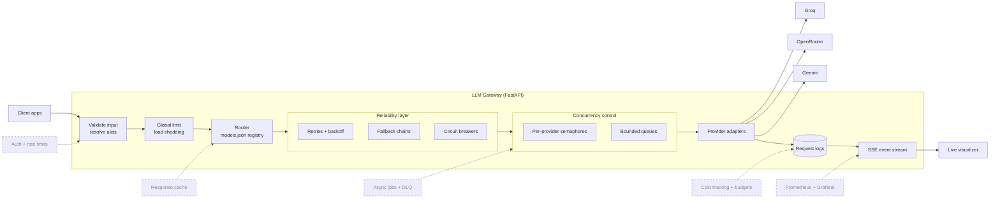
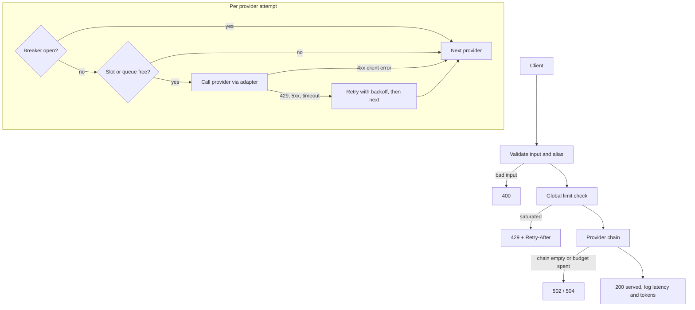

# LLM Gateway

A reliability layer that sits between your apps and LLM providers. One API in front, with failover, concurrency control and live observability behind it, so a provider outage or traffic spike never becomes your outage.

> **Status: in progress.** The reliability and concurrency core is built and tested. Auth, caching, async jobs with a DLQ, cost tracking and full observability are being built next. See [Status](#status) for the exact split.

## Architecture



Solid boxes are built. Dashed boxes are planned and slot into the same pipeline.

## Why this exists

Apps that call LLM providers directly run into the same problems:

| Problem | Without a gateway | With this gateway |
|---|---|---|
| Provider outage or rate limit | The app goes down | Retries, then falls back to the next provider |
| Traffic spike | Unbounded concurrency, 429 storms, memory growth | Semaphores, bounded queues, load shedding with `Retry-After` |
| Failing provider | Every request keeps hitting it | Circuit breaker skips it, then probes it |
| Switching models | Edit every app | Change one line in `models.json` |
| "Why is it slow?" | No idea | Per-request logs and a live traffic visualizer |
| API keys | Spread across services | Held only by the gateway |

## Status

| Area | Feature | State |
|---|---|---|
| Core | Unified chat API, request validation, per-request latency and token logging | Built |
| Routing | Alias routing (`fast`, `smart`, `cheap`) driven by a single `models.json` registry | Built |
| Providers | Adapters for Gemini, Groq and OpenRouter | Built |
| Reliability | Error classification, retries with exponential backoff and jitter, ordered fallback chains | Built |
| Reliability | Per-provider circuit breakers (closed, open, half-open) | Built |
| Concurrency | Global and per-provider semaphores, bulkhead pools, bounded queues, load shedding (`429` + `Retry-After`) | Built |
| Safety | Startup smoke test for every model in every chain | Built |
| Observability | Live visualizer fed by server-sent events (requests, fallbacks, queue depth, shed requests) | Built |
| Security | Gateway API keys, per-key rate limits | In progress |
| Cost | Response cache, request coalescing, cost tracking and budgets | In progress |
| Async | Job queue, idempotency keys, dead letter queue with replay | In progress |
| Observability | Prometheus and Grafana, tracing, alerts | Planned |
| Security | Prompt-injection and PII guardrails, OWASP LLM Top 10 test suite | Planned |

## Request flow



### Request outcomes

| What happens | What the gateway does | Client sees |
|---|---|---|
| Healthy path | Validate, limit, call provider | `200` |
| Unknown alias or invalid input | Reject before any provider call | `400` |
| Gateway saturated | Shed the request | `429` + `Retry-After` |
| Breaker open for a provider | Skip it, try the next one | `200` via fallback |
| Provider slots full, queue full or wait exceeded | Skip it, try the next one | `200` via fallback |
| `429`, `5xx` or timeout from a provider | Retry with backoff, count towards the breaker, then next | `200` via fallback |
| `400`, `401`, `403` from a provider | No retry, does not count towards the breaker, next provider | `200` via fallback |
| Chain exhausted or time budget spent | Stop | `502` or `504` |

## Quick start

```bash
git clone https://github.com/<your-username>/llm-gateway.git
cd llm-gateway
python -m venv .venv
source .venv/bin/activate        # Windows: .venv\Scripts\activate
pip install -r requirements.txt

cp .env.example .env              # add your provider keys
uvicorn app.main:app --reload
```

Then open `http://localhost:8000/docs` for the interactive API docs.

```bash
curl -X POST http://localhost:8000/v1/chat \
  -H "Content-Type: application/json" \
  -d '{"model": "fast", "messages": [{"role": "user", "content": "Explain an API gateway in 2 lines."}]}'
```

The response includes the reply, token usage, latency, which provider served it, whether a fallback was used and the attempt details.

## Configuration

Everything about routing and limits lives in `models.json`. Nothing is hardcoded in Python.

```jsonc
// trimmed example
{
  "concurrency": {
    "global_max_inflight": 50,
    "providers": {
      "groq": { "max_inflight": 10, "max_queue_size": 20, "max_queue_wait_sec": 5.0 }
    }
  },
  "fast": {
    "provider": "groq",
    "model": "openai/gpt-oss-120b",
    "fallback": [
      { "provider": "gemini", "model": "gemini-2.5-flash" }
    ],
    "input_price_per_token": 0.00000005,
    "output_price_per_token": 0.0000002,
    "context_limit": 131072
  }
}
```

An alias is an intent (`fast`, `smart`, `cheap`) mapped to an ordered chain of provider and model pairs. Swapping a model is a config change, not a code change.

## API

| Endpoint | Purpose |
|---|---|
| `GET /health` | Liveness check |
| `POST /v1/chat` | Chat completion through the gateway |
| `GET /api/reliability/status` | Fallback chains and circuit breaker state |
| `GET /api/concurrency/status` | In-flight, queue depth, wait times and rejections per provider |

## Testing

```bash
pytest tests/                     # mocked tests plus live provider tests
pytest tests/ -k mocked           # mocked tests only, no API keys needed
```

The mocked suite covers: error classification, breaker transitions, retries, fallback execution, non-retryable errors aborting retries, semaphore limits never exceeded, queue timeout, load shedding with `Retry-After`, slot release after errors, bulkhead isolation, and saturation not tripping the breaker.

Load test:

```bash
python scripts/load_test_concurrency.py
```

## Load test results

Numbers will be added here once the load test runs against a mock provider with realistic capacity limits, reporting latency for served requests separately from shed requests.

| Metric | Limits off | Limits on |
|---|---|---|
| Served (200) | TBD | TBD |
| Shed (429) | TBD | TBD |
| p50 / p95 / p99, served only | TBD | TBD |
| Peak memory delta | TBD | TBD |

## Design decisions

- **Bulkheads per provider.** A slow provider can only exhaust its own pool, never the others.
- **Saturation is not failure.** A full queue does not trip the circuit breaker, only real provider failures do.
- **Only retryable errors count.** Client errors (`400`, `401`, `403`) never open a breaker, otherwise one bad request could take a healthy provider offline.
- **Single source of truth.** Aliases, chains, prices and limits all come from `models.json`.
- **Fail loudly at startup.** The smoke test checks every model in every chain, so stale model names surface immediately.

## Known limitations

- End-to-end request deadline enforcement is being tightened so total time can never exceed the configured budget.
- State (breakers, queues) is in memory, so it is per instance. A shared store is planned.
- Logs use SQLite, which is fine for development but not for multiple replicas.
- `app/main.py` is large and will be split into modules.

## Roadmap

1. Close the deadline and load-test gaps above
2. Gateway API keys and per-key rate limits (Redis)
3. Response cache with request coalescing
4. Async jobs, idempotency keys and a dead letter queue with replay
5. Cost tracking and budgets per key
6. Prometheus, Grafana and tracing
7. Guardrails and an OWASP LLM Top 10 test suite
8. Chaos tests, deployment and a write-up on the bugs found in AI-written code

## License

MIT
