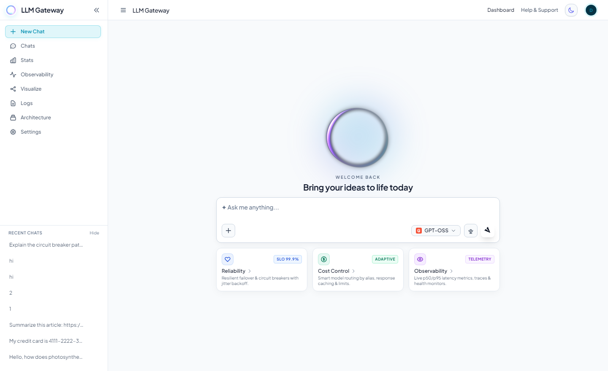
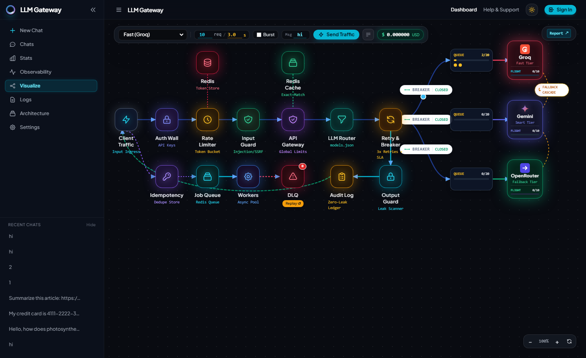
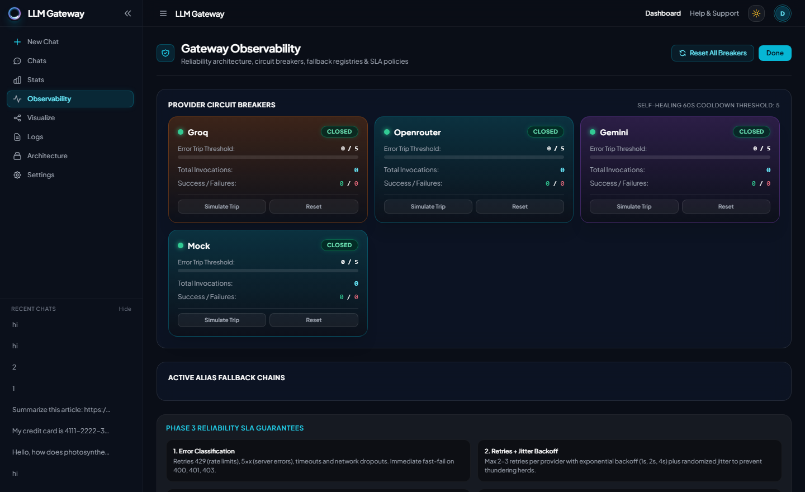
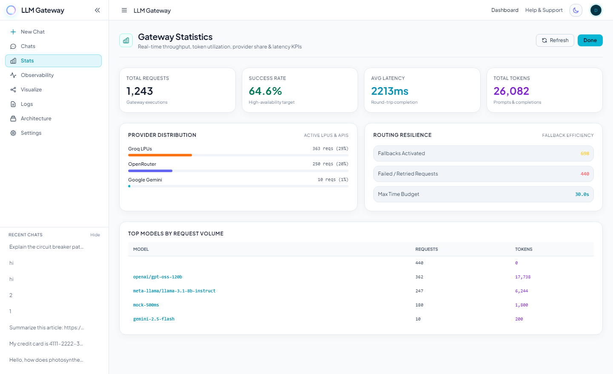
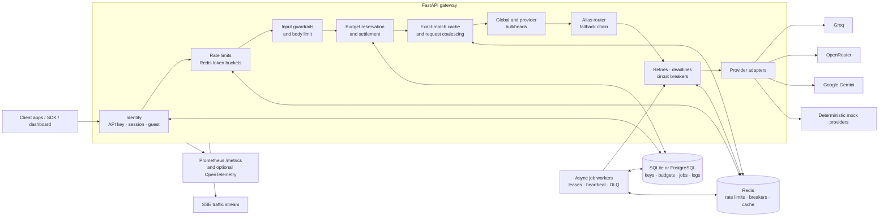
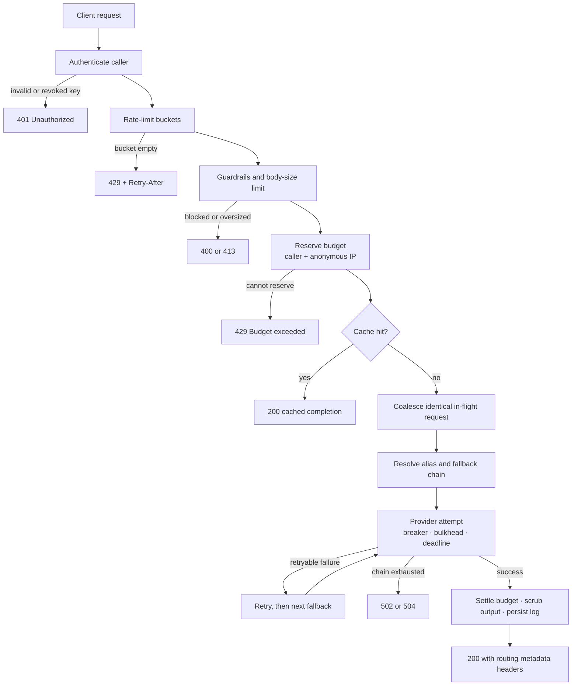

# LLM Gateway

**One API in front of multiple LLM providers, with the reliability and isolation controls a raw provider SDK leaves to you.**

[](https://github.com/Tushar01yadav/LLM-Gateway/actions/workflows/ci.yml)

`Python 3.10` · `FastAPI` · `Redis` · `SQLite / PostgreSQL` · `Docker` · `Prometheus` · `OpenTelemetry`

LLM Gateway is a FastAPI service that accepts chat requests, resolves a model alias
into a provider fallback chain, and executes it through authentication, rate limits,
guardrails, budgets, bulkheads, retries, and circuit breakers. It also provides a
browser dashboard, asynchronous jobs, audit logs, metrics, and optional tracing.

**Links:** [60-second demo](docs/demo.md) · [verified claims](CLAIMS.md) ·
[multi-instance evidence](docs/multi-instance-reliability.md) ·
[CI and local verification](docs/ci-testing.md)

---

## What this is, and what it is not

A thin LLM wrapper maps one request to one provider call. This project treats each
request as an attempt in a managed chain:

- **Failures are expected.** Requests have a 30-second deadline, retry transient
  provider errors with jitter, and move through an ordered fallback chain when a
  provider is unhealthy.
- **State outlives a process.** Daily budget reservations, async jobs, leases,
  idempotency records, API keys, and audit logs live in SQLite or PostgreSQL.
  Rate-limit buckets and circuit-breaker coordination live in Redis.
- **Capacity is bounded.** Global and per-provider bulkheads, bounded queues, and
  explicit `429 + Retry-After` shedding keep a degraded provider from consuming the
  whole gateway.
- **Operators can see what happened.** Every request logs provider, model, latency,
  tokens, cost, fallback use, and queue wait. The dashboard exposes breaker state,
  percentile latency, provider distribution, and a live traffic view.

It is a single-region service with deliberately documented limits, not a claim of
production-scale traffic. The [limitations](#limitations-and-next-steps) section
lists what it does not guarantee.

---

## Interface

The dashboard is served by the gateway itself. Screenshots below come from a local
demo run that includes injected faults; the numbers are illustrative, not capacity
benchmarks.

### Chat

A unified chat view with model selection, session history, and routing metadata.



### Live traffic visualizer

`/visualize` animates request lifecycle events from the SSE stream: ingress, auth,
rate limiting, guardrails, cache, routing, retries, fallback, and provider nodes.
It also exposes admin-only fault controls for local demonstrations.



### Provider health and circuit breakers

`/observability` shows provider and model breaker state, failure thresholds,
cooldowns, fallback chains, and administrative trip/reset controls.



### Statistics

`/stats` summarizes request volume, success rate, latency percentiles, token usage,
provider distribution, and routing resilience.



---

## Architecture



### What is authoritative where

| State | Authoritative store | Coordination | Behavior when the store is unavailable |
|---|---|---|---|
| Daily budgets and reservations | SQLite or PostgreSQL | Atomic conditional updates per caller account | The budgeted request path is rejected; there is no local admission fallback |
| Rate-limit buckets | Redis | One Lua token bucket per caller/IP | Fail closed with `429`, or use process-local buckets when fail-open is configured |
| Circuit breakers | Redis hashes and Lua leases | Shared state and one half-open probe across instances | Process-local breaker state continues; distributed probe coordination is lost |
| Response cache | Redis | Shared exact-match keys | A bounded process-local LRU cache is used |
| Async jobs and leases | SQLite or PostgreSQL | Conditional claim, lease check, tenant scope | Job state and claims require the database; Redis notifications alone cannot execute work |
| Keys, sessions, audit and request logs | SQLite or PostgreSQL | Database constraints and scoped queries | Persistence failures are logged and surfaced rather than silently discarded |

The multi-process topology, guarantees, and failure boundaries are documented in
[docs/multi-instance-reliability.md](docs/multi-instance-reliability.md).

---

## Request lifecycle



| Outcome | Gateway behavior | Client sees |
|---|---|---|
| Healthy request | Validate, authenticate, reserve budget, call provider, sanitize output | `200 OK` |
| Invalid or revoked credential | Reject before any provider call | `401` |
| Anonymous caller | Issue an HMAC-signed guest identity and apply guest plus IP-scoped limits | `200` with `X-Guest-ID` |
| Rate limit exhausted | Atomic token-bucket rejection | `429 + Retry-After` |
| Oversized or blocked input | Body limit or guardrail rejects before routing | `400` or `413` |
| Budget unavailable | Atomic reservation fails | `429` |
| Provider or gateway saturated | Bulkhead queue or deadline is exhausted before a healthy call | `429 + Retry-After` |
| Provider transient failure | Retry with jitter, then try the next fallback | `200` via fallback, or `502/504` |
| Provider client error | Do not retry that provider; continue the chain | `200` via fallback, or `502` |
| All providers unavailable | Return the chain failure | `502 Bad Gateway` or `504 Gateway Timeout` |
| Cache hit | Return the scoped cached response and log the hit | `200` |

Successful responses expose non-sensitive metadata: `X-Request-Id`, `X-Provider`,
`X-Model`, `X-Fallback-Used`, `X-Latency-Ms`, `X-Cost-USD`, and, for guests,
`X-Guest-ID`. The implementation starts in `app/main.py` at the `/v1/chat` handler.

---

## Core engineering capabilities

### Multi-provider routing and failover

Routes are configured in `models.json`, not hardcoded per endpoint. An alias
resolves to a primary provider/model plus an ordered fallback list. Direct model
IDs are also accepted.

| Alias | Primary | Fallback order |
|---|---|---|
| `fast` | Groq `openai/gpt-oss-120b` | OpenRouter `meta-llama/llama-3.1-8b-instruct`, then Gemini `gemini-2.5-flash` |
| `smart` | Gemini `gemini-2.5-flash` | Groq `llama-3.3-70b-versatile`, then OpenRouter `meta-llama/llama-3.3-70b-instruct` |
| `cheap` | OpenRouter `meta-llama/llama-3.1-8b-instruct` | Groq `llama-3.1-8b-instant`, then Gemini `gemini-2.5-flash` |
| `mock` | Local deterministic mock | None |
| `mock_failover` | Local mock | Second local mock provider |

Native adapters exist for Groq, OpenRouter, and Gemini; the mock adapters make
reliability tests deterministic and key-free. Adding a provider means adding an
adapter and a `models.json` entry.

### Retries, deadlines, and circuit breakers

`execute_reliable_completion` (`app/reliability.py`) runs the chain under a
30-second total deadline. A provider normally gets up to three attempts
(`max_retries_per_provider=2`) with jittered backoff, and the per-call timeout is
capped at 15 seconds or the remaining budget. Timeouts, network errors, `429`, and
`5xx` are retryable; `400`, `401`, `403`, `404`, and `422` are not.

Circuit breakers default to 5 consecutive failures, a 60-second recovery timeout,
and a 30-second half-open probe lease. State transitions and probe permits are
executed atomically in Redis with version fencing, so two gateway processes cannot
both own the half-open probe. A successful fallback does not close the primary
breaker. Administrative provider breakers are separate from model-scoped breakers.
See [docs/circuit-breakers.md](docs/circuit-breakers.md).

### Concurrency, queues, and backpressure

The default configuration admits at most **50** in-flight provider calls globally
and **10 per provider** (`mock2` allows 20). Each provider has a bounded queue
(20 slots; 40 for `mock2`) with a 5-second maximum wait. When the queue or deadline
is exhausted, the gateway returns `429 + Retry-After` instead of pushing the
provider further into failure.

These semaphores and queues are **process-local**. Running more gateway processes
increases aggregate capacity; it does not create a global distributed semaphore.
This is stated explicitly in the multi-instance verification.

### Distributed rate limiting and anonymous isolation

`RedisTokenBucketRateLimiter` uses one atomic Lua script with Redis server time.
The default quota is 60 requests per minute, refilling at one token per second.
Buckets are scoped as `key:<id>`, `user:<id>`, or `guest:<id>`.

Anonymous callers also consume a shared `ip:<address>` bucket, so clearing the
guest cookie and presenting a new identity does not mint fresh quota. Guest IDs are
HMAC-signed (`guest_<random>_<signature>`); forged identities are rejected. Client
IPs are resolved through `TRUSTED_PROXY_COUNT`, and uvicorn must run with
`--no-proxy-headers` so the application, not uvicorn's default middleware, decides
which forwarded headers to trust.

If Redis is unreachable, the configured policy decides the behavior:

- `RATE_LIMIT_FAIL_MODE=closed` rejects requests with `429`.
- `open` uses a bounded process-local LRU token bucket (10,000 buckets, one-hour
  idle expiry). Those decisions are not shared across workers.

### Daily budgets: reserve, settle, release

Before a provider call, the gateway reserves an estimated daily cost in the
database against the caller's account. The reservation is an atomic conditional
update, so simultaneous requests cannot jointly exceed the account limit. After the
call, the reservation is settled against actual token usage and becomes a cost
record. Failures and cancellations release the reservation. Expired reservations
are reclaimed, which is the recovery path after a process crash.

Anonymous guests reserve against both their guest account and an IP-scoped daily
cap shared by all anonymous requests from that IP (default **$5.00**, configurable
via `GATEWAY_ANONYMOUS_IP_DAILY_BUDGET_USD` or
`cost_control.anonymous_ip_daily_budget_usd`). The database is authoritative for
admission; Redis is not used to approve budgets. See
[docs/budget-enforcement.md](docs/budget-enforcement.md).

Estimates are deliberately conservative, but a provider can return more tokens
than reserved. The guarantee is bounded admission, not an exact hard cap.

### Async jobs: leases, idempotency, and DLQ

`POST /v1/jobs` persists a job row, then notifies workers through Redis. The
database remains the source of truth: a worker must win a conditional lease claim
before executing. Jobs heartbeat every 5 seconds against a 15-second lease (both
configurable). If a worker dies, another worker can reclaim the job after lease
expiry. Retries stop at the configured attempt limit, after which the job moves to
the dead-letter queue. DLQ replay preserves the job and idempotency identity.

Idempotency is scoped to `(key_id, idempotency_key)`, backed by a unique
constraint. Concurrent submissions for the same tenant and key return the winning
job rather than enqueueing a duplicate.

Execution is **at least once**, not exactly once. A crash after the upstream call
but before commit can cause the provider call to happen again. See
[docs/async-jobs.md](docs/async-jobs.md).

### Exact-match cache and request coalescing

The response cache key is a SHA-256 over caller scope, alias, model, temperature,
`max_tokens`, and normalized messages. Including caller scope prevents one tenant
from reading another tenant's cached completion. Entries live in Redis for one hour
by default and are never written for errors or empty responses. When Redis is
unavailable, a bounded local cache (1,000 entries, 16 MiB) is used per process.

The request coalescer shares one in-flight provider call among identical concurrent
requests. Followers wait on the leader's future with a 120-second timeout. This is
also process-local. See [docs/degraded-mode.md](docs/degraded-mode.md).

### Request-body and input protection

A pure ASGI middleware (`app/body_limit.py`) enforces the configured request-body
limit (1 MiB by default) before routing. It pre-checks `Content-Length` and also
counts streamed/chunked bodies, stops reading on overflow, returns `413`, and
closes the connection when HTTP/2 is not in use.

Guardrails add a deterministic defensive layer:

- Prompt-injection pattern matching after NFKC normalization, zero-width/control
  stripping, and case folding.
- SSRF checks for private and loopback targets.
- Hard-secret detection and redaction.
- PII detection that is **flagged in audit records, not silently rewritten**.
- Output scanning for leaked secrets, environment credentials, and configured
  system prompts.

This is a heuristic baseline, not a complete injection boundary. Documented bypass
classes and policy details are in
[docs/security-findings.md](docs/security-findings.md).

### Observability

- **Prometheus:** `/metrics` exports low-cardinality HTTP request counters,
  duration histograms, in-flight gauges, rate-limit outcomes, cache lookups, and
  domain counters. The Compose stack provisions Grafana and a request overview
  dashboard from `observability/`.
- **Statistics:** `/api/stats` computes nearest-rank p50/p95/p99 over a rolling
  window of persisted request logs. Latency is never represented by an average
  alone.
- **Live events:** `/api/reliability/traffic-stream` broadcasts SSE events for
  cache hits, retries, breaker state, rate limits, jobs, and cost updates. The
  broadcaster is per process, so subscribers see only events from the gateway they
  are connected to.
- **Tracing:** opt-in OpenTelemetry with OTLP HTTP/protobuf. FastAPI request spans
  exclude `/metrics`; manual spans cover provider calls and job execution. Async
  jobs persist a W3C `traceparent`, so the worker span continues the submitting
  request trace. URLs, headers, exception messages, and stack traces are redacted
  before export. Without `OTEL_ENABLED=true` and an endpoint, tracing is disabled.
  See [docs/tracing.md](docs/tracing.md).

---

## Engineering decisions and trade-offs

| Decision | Why | Cost or limit |
|---|---|---|
| Redis for rate limits and breaker coordination | Atomic Lua operations give consistent decisions across processes at low latency | A Redis outage loses distributed coordination; the gateway either rejects or falls back to process-local state |
| Database for budgets, jobs, keys, and logs | Durable state with transactions and unique constraints | Extra write latency per request; jobs are at least once, not exactly once |
| Process-local bulkheads and coalescing | Cheap isolation with no distributed semaphore to operate | Aggregate capacity grows with process count; no global in-flight cap |
| Reserved budgets with later settlement | Prevents concurrent requests from over-admitting spend | Actual usage can exceed the estimate; the cap is approximate at the boundary |
| Exact-match cache rather than semantic cache | Predictable correctness and simple tenant isolation | Paraphrased prompts do not hit the cache |
| Heuristic guardrails | Deterministic, dependency-free, and fast | Homoglyphs, token obfuscation, encodings, and novel paraphrases can bypass patterns |
| Pure ASGI body limit | Applies before routing and to chunked bodies without buffering the request | Enforces a transport-level limit; it is not a content-type or schema validator |
| Opt-in tracing | No collector dependency for local or minimal deployments | Exported spans can be dropped under collector failure; tracing is not always on |

---

## Testing and reliability evidence

The suite uses a deterministic mock provider for routine tests and real
PostgreSQL/Redis services for integration and multi-process checks. Results below
were verified against the released commit `300ab92` on 2026-11-16 in a local
Windows environment (Python 3.10).

| Suite | What it exercises | Result |
|---|---|---|
| Full regression (`python -m pytest -q`) | Unit, API, security, guardrail, cache, budget, jobs, tracing, and UI checks | **213 passed, 16 skipped**; one known Windows-only CRLF/SRI check fails |
| PostgreSQL integration stage | Budget reservations, job crash safety, session persistence, legacy budget migration | **18 passed** |
| Multi-instance Compose stage | Two Uvicorn processes sharing PostgreSQL and Redis; budget race, shared token bucket, breaker probe ownership, crash recovery, Redis pause, 10/50/100-request consistency | **8 passed** |
| Post-merge focused smoke | Release-critical paths after merging to `main` | **43 passed** |

The single failure is a known Windows environment issue:
`test_dashboard_supply_chain.py::test_every_vendored_script_matches_its_sri_hash`
compares LF-based SRI hashes against files that Git checked out with CRLF line
endings. It reproduces at the base commit and is not a product regression.

What the tests validate:

- Budget reservations remain isolated per tenant and cannot be jointly over-admitted
  by concurrent processes.
- A shared Redis token bucket limits one API key across gateway processes.
- One half-open breaker probe is granted across processes, and an abandoned probe
  lease can be reclaimed.
- A killed worker's job is recovered after lease expiry and completes with one cost
  record.
- Fail-closed rate limiting rejects during a Redis pause and recovers afterward.
- Cached responses never cross caller scopes, jobs are tenant-scoped, and invalid
  keys are rejected while the anonymous guest path remains isolated.

What they do not prove: throughput, latency SLOs, production capacity, multi-region
failover, or exactly-once execution. CI stages A-F are defined in
`.github/workflows/ci.yml`.

### Benchmark records

`docs/benchmarks/` contains before/after load, overload, chaos, job-recovery, and
percentile records. They are measurements from one Windows host and are explicitly
host-bound, not performance targets. The overload record illustrates the intended
trade-off: when the provider cannot serve healthy concurrency, the gateway converts
provider `5xx` responses into explicit `429` shedding instead of passing failures
through. See
[docs/benchmarks/phase4-load-overload-before-after.md](docs/benchmarks/phase4-load-overload-before-after.md).

---

## Technology stack

| Area | Used here |
|---|---|
| Runtime | Python 3.10, FastAPI 0.143.2, Pydantic 2.13.4, Uvicorn 0.30.1 |
| HTTP and provider clients | `httpx` 0.28.1 |
| Shared coordination | Redis 7.4 with `redis` 5.0.6 and Lua scripts |
| Persistence | SQLite by default; PostgreSQL 16 through `psycopg` 3.2.9 and `DATABASE_URL` |
| Security | SHA-256 key hashing, HMAC guest identities, `cryptography` 50.0.0 for OAuth token encryption |
| Observability | `prometheus-client` 0.26.0, OpenTelemetry SDK/API 1.45.2, FastAPI instrumentation 0.66b2 |
| Dashboard | Server-served HTML/JS with vendored Tailwind 3.4.16, marked 12.0.2, and DOMPurify 3.1.6, pinned with SRI |
| Testing | pytest 8.3.4, pytest-asyncio 0.25.2, Docker Compose integration stages |
| Packaging | Docker image on `python:3.10-slim`, non-root UID 10001, `/health` healthcheck |

---

## Run locally

### 1. Install

```bash
git clone git@github.com:Tushar01yadav/LLM-Gateway.git
cd LLM-Gateway

python -m venv .venv
# Windows: .\.venv\Scripts\Activate.ps1
# Linux/macOS:
source .venv/bin/activate

pip install -r requirements.txt
cp .env.example .env
```

`GATEWAY_ADMIN_TOKEN` is required; the application refuses to start without it.
Provider keys are optional for mock-only runs. Redis is optional for a single
process but required for shared rate limits and breaker coordination. Leaving
`DATABASE_URL` empty uses SQLite; setting it switches the persistence layer to
PostgreSQL.

| Variable | Purpose | Default |
|---|---|---|
| `GATEWAY_ADMIN_TOKEN` | Admin authentication and guest-signing fallback | Required |
| `REDIS_URL` | Rate limits, breakers, cache, job notifications | `redis://127.0.0.1:6379/0` |
| `RATE_LIMIT_FAIL_MODE` | `closed` rejects during a Redis outage; `open` uses local buckets | From `models.json` (`open`) |
| `TRUSTED_PROXY_COUNT` | Number of trusted reverse proxies; `0` ignores `X-Forwarded-For` | `0` |
| `DATABASE_URL` | PostgreSQL connection string | Empty (SQLite) |
| `GATEWAY_ANONYMOUS_IP_DAILY_BUDGET_USD` | Daily cap shared by anonymous requests per IP | `5.0` |
| `GATEWAY_JOB_LEASE_SECONDS` / `GATEWAY_JOB_HEARTBEAT_SECONDS` | Async job lease and heartbeat | `15` / `5` |
| `OTEL_ENABLED` / `OTEL_EXPORTER_OTLP_TRACES_ENDPOINT` | Opt-in tracing and OTLP endpoint | Disabled |

See [.env.example](.env.example) for the complete list, including OAuth, SMTP, and
Grafana demo settings.

### 2. Start the gateway

```bash
uvicorn app.main:app --host 0.0.0.0 --port 8000 --reload --no-proxy-headers
```

Use `--no-proxy-headers` in every deployment. It keeps `request.client` from being
rewritten by uvicorn's default forwarded-header middleware, which would bypass
`TRUSTED_PROXY_COUNT`.

Production-style start with multiple workers and shared Redis:

```bash
APP_ENV=production \
GATEWAY_ADMIN_TOKEN="$(cat /run/secrets/gateway_admin_token)" \
TRUSTED_PROXY_COUNT=1 \
REDIS_URL=redis://redis:6379/0 \
uvicorn app.main:app --host 0.0.0.0 --port 8000 --no-proxy-headers --workers 2
```

With `APP_ENV=production`, startup refuses a configuration where
`TRUSTED_PROXY_COUNT > 0` but proxy headers are not provably disabled.

### 3. Docker

```bash
docker build -t llm-gateway .
docker run --rm -p 8000:8000 \
  -e GATEWAY_ADMIN_TOKEN=change-me \
  -e GROQ_API_KEY=... -e OPENROUTER_API_KEY=... -e GEMINI_API_KEY=... \
  llm-gateway
```

To persist SQLite across restarts, bind-mount a pre-created host **file** at
`/app/gateway.db`, writable by UID 10001. A named volume at that path becomes a
directory and SQLite fails to open it. Never mount a host directory over `/app`;
it would shadow the application code in the image.

### 4. One-command demo

```bash
docker compose up --build
```

This starts the gateway, Redis, Prometheus, Grafana, and a scripted demo client.
No provider keys are required. The client checks health, sends chat requests,
inspects response headers, injects a `503` on the primary mock, and confirms
`mock_failover` serves from the second mock with `X-Fallback-Used: true`.

- Dashboard and visualizer: `http://localhost:18000/visualize`
  (paste `demo-admin-token` in Settings to unlock admin controls)
- Prometheus: `http://localhost:19090`
- Grafana: `http://localhost:13000`

Shut down and remove demo state with `docker compose down -v`.

### 5. Configuration model

`models.json` is the registry for aliases, fallback chains, token prices, guardrail
limits, rate-limit policy, and concurrency pools. Costing uses the alias entry
first and falls back to the model entry, so fallback routing does not change the
alias price.

```jsonc
"fast": {
  "provider": "groq",
  "model": "openai/gpt-oss-120b",
  "fallback": [
    { "provider": "openrouter", "model": "meta-llama/llama-3.1-8b-instruct" },
    { "provider": "gemini", "model": "gemini-2.5-flash" }
  ],
  "input_price_per_token": 0.00000005,
  "output_price_per_token": 0.00000008,
  "context_limit": 131072
}
```

---

## API examples

### Guest chat

No credential is required for the dashboard guest path. The first response issues
an HMAC-signed guest cookie and `X-Guest-ID`; reuse the cookie to keep the same
guest-scoped quota and budget.

```bash
curl -c cookies.txt -X POST http://localhost:8000/v1/chat \
  -H "Content-Type: application/json" \
  -d '{
    "alias": "mock",
    "messages": [{"role": "user", "content": "Explain circuit breakers briefly."}]
  }'
```

### Create an API key

```bash
curl -X POST http://localhost:8000/api/gateway-keys \
  -H "X-Admin-Token: $GATEWAY_ADMIN_TOKEN" \
  -H "Content-Type: application/json" \
  -d '{"name": "demo", "quota": 60, "daily_budget": 5.0}'
```

The plaintext key is returned once. Store it securely; only its hash is persisted.

### Authenticated chat

```bash
curl -D - -X POST http://localhost:8000/v1/chat \
  -H "Authorization: Bearer gw_live_..." \
  -H "Content-Type: application/json" \
  -d '{
    "alias": "fast",
    "messages": [{"role": "user", "content": "Summarize the CAP theorem."}],
    "max_tokens": 300
  }'
```

### Async job with idempotency

```bash
curl -X POST http://localhost:8000/v1/jobs \
  -H "Authorization: Bearer gw_live_..." \
  -H "Idempotency-Key: report-2026-11-16" \
  -H "Content-Type: application/json" \
  -d '{
    "alias": "mock",
    "messages": [{"role": "user", "content": "Generate a short report."}]
  }'

curl -H "Authorization: Bearer gw_live_..." \
  http://localhost:8000/v1/jobs/job_...
```

### Selected endpoints

| Category | Method and path | Purpose |
|---|---|---|
| Chat | `POST /v1/chat` | Unified completion with failover, limits, budgets, and guardrails |
| Jobs | `POST /v1/jobs` | Enqueue an asynchronous completion |
| Jobs | `GET /v1/jobs/{job_id}` | Poll a tenant-scoped job |
| DLQ | `GET /v1/dlq`, `POST /v1/dlq/{job_id}/replay` | Inspect or replay failed jobs (admin) |
| Stats | `GET /api/stats` | Request totals and latency percentiles |
| Reliability | `GET /api/reliability/status` | Breaker and fallback state |
| Visualizer | `GET /api/reliability/traffic-stream` | SSE event stream |
| Keys | `POST /api/gateway-keys` | Create a scoped API key (admin) |
| Audit | `GET /api/audit-logs` | Recent scrubbed security events (admin) |
| Metrics | `GET /metrics` | Prometheus exposition |
| Health | `GET /health` | Liveness check |

---

## Limitations and next steps

- **Process-local controls:** global/provider bulkheads, request coalescing, the
  local cache fallback, and the SSE broadcaster are per process. Multi-process
  deployments scale aggregate capacity; they do not enforce a global concurrency
  cap.
- **At-least-once jobs:** a crash after an upstream call but before commit can
  repeat provider work. Duplicate delivery is bounded by leases and idempotency,
  not eliminated.
- **Approximate budget boundary:** admission uses an estimate; actual provider
  usage can exceed the reservation. There is no monthly or global budget.
- **Heuristic guardrails:** cross-script homoglyphs, letter-spaced instructions,
  encoded payloads, and novel paraphrases can bypass pattern matching.
- **Redis dependency:** fail-open mode permits uncoordinated local quotas during an
  outage; fail-closed mode rejects requests. Breaker coordination is only
  distributed while Redis is reachable.
- **Exact-match caching:** no semantic or embedding-based cache, so paraphrased
  prompts miss.
- **Operational scope:** verification covers a single host and local multi-process
  Compose topology, not multi-region partitions, managed-service failover, or
  production-scale traffic. Benchmark numbers are host-bound.
- **Tracing is best-effort:** the batch exporter can drop spans during collector
  failures, and tracing is disabled without an endpoint.
- **UI burst control:** the visualizer exposes burst controls, but their
  simultaneous-request capacity has not been load-verified in a browser.

Natural extensions are distributed concurrency quotas, semantic caching with strict
tenant isolation, stronger injection detection, and hosted multi-region verification.

---

## Working with AI coding assistants

- Avoid pasting raw GitHub web URLs into browsing tools; they often fetch only the
  page shell rather than source files.
- Connect the repository through a code-aware assistant or use
  [Gitingest](https://gitingest.com/Tushar01yadav/LLM-Gateway) / Repomix to build a
  token-efficient source bundle.
- Local databases, scratch files, and generated artifacts are excluded by
  `.gitignore`; see [CLAIMS.md](CLAIMS.md) for the claims that can be reproduced.

---

## License

MIT — see [LICENSE](LICENSE).
