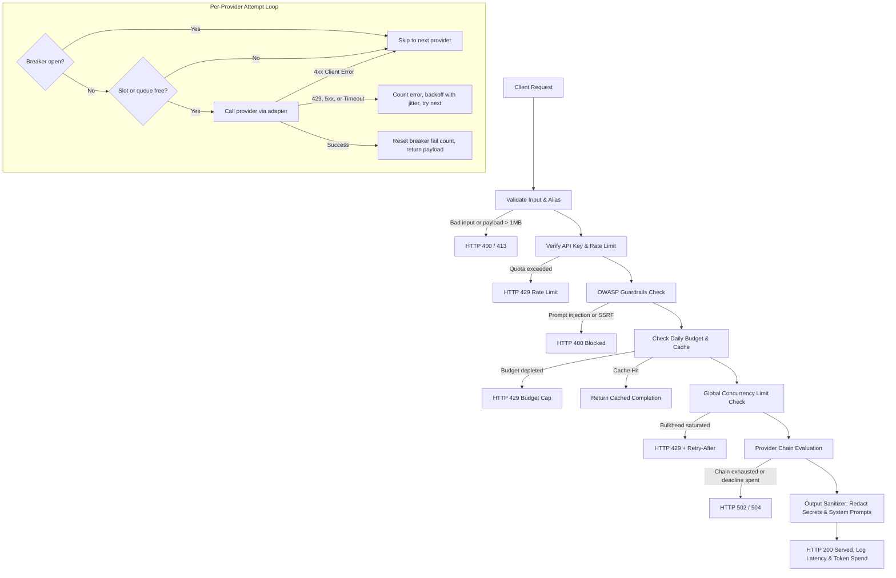

# LLM Gateway

A high-performance reliability, security, and governance layer that sits between your applications and LLM providers. One unified API in front, with automated multi-provider failover, concurrency control, OWASP Top 10 guardrails, cost governance, async jobs with a Dead Letter Queue (DLQ), and a live observability visualizer behind it—so a provider outage, traffic spike, or budget overrun never becomes your outage.

---

## Architecture

```mermaid
flowchart LR
    Client["Client apps"]

    subgraph GW["LLM Gateway (FastAPI)"]
        direction TB
        V["Validate input & alias"]
        SEC["Security & Auth<br/>Per-key rate limiting"]
        GR["OWASP Guardrails<br/>Injection & PII scrub"]
        CG["Cost Guard<br/>Budget & cache check"]
        GL["Global limit<br/>load shedding"]
        R["Router<br/>models.json registry"]
        
        subgraph REL["Reliability layer"]
            direction TB
            RT["Retries + jitter backoff"]
            FB["Ordered fallback chains"]
            CB["Circuit breakers"]
        end
        
        subgraph CON["Concurrency control"]
            direction TB
            SEM["Per-provider semaphores"]
            Q["Bounded queues"]
        end
        
        AD["Provider adapters"]
        SAN["Response sanitization<br/>Secret & prompt scrub"]
        LOG[("Audit & request logs")]
        EV["SSE event stream"]
    end

    Client --> V --> SEC --> GR --> CG --> GL --> R --> REL --> CON --> AD
    AD --> GROQ["Groq Cloud"]
    AD --> OR["OpenRouter"]
    AD --> GEM["Google Gemini"]
    AD --> SAN --> LOG
    LOG --> EV --> VIZ["Live Visualizer (/visualize)"]

    JOBS["Async jobs + DLQ (/v1/jobs)"] -.-> CON
```



---

## 🖥️ Live Observability & Traffic Visualizer


The built-in **Interactive Topology Visualizer** (`http://localhost:8000/visualize`) offers real-time visual tracking of request lifecycles under varying traffic conditions:
- **Request Node Traveling:** Watch request nodes travel dynamically across cables in real time—entering at **Client Ingress**, passing through **Auth Wall**, **Token-Bucket Rate Limiter**, **OWASP Input Guard**, and **Cache**, through the **Router** to upstream provider nodes.
- **Simulating Burst & Sustained Traffic:** Built-in load testing controls allow you to simulate individual requests, steady streams (e.g. 10 requests over 3s), or high-concurrency **Burst Mode** floods (e.g. 50–100+ simultaneous requests).
- **Safety & Resiliency in Action:** Visually observe how the gateway isolates load: semaphores queue in-flight requests, bulkheads shed excess load (`429 + Retry-After`), and circuit breakers automatically switch from `CLOSED` to `OPEN` to reroute traffic down the fallback cascade when an upstream provider degrades.

---

## Why This Exists

Applications that invoke upstream LLM providers directly encounter predictable systemic vulnerabilities:

| Problem | Without a Gateway | With this Gateway |
|---|---|---|
| **Provider outage or rate limit (429)** | The client app crashes | Retries with jitter, then automatically fails over to the next provider |
| **Traffic spikes & runaway concurrency** | Memory spikes, 429 storms, server failure | Semaphores, bounded queues, and load shedding with `429 + Retry-After` |
| **Failing provider degradation** | Repeatedly hammered by failing requests | Circuit breaker trips to `OPEN`, skipping failing nodes until health probes pass |
| **Prompt injection & system prompt leaks** | Vulnerable to DAN exploits & directive theft | Pre-execution regex inspection & automated post-execution secret redaction |
| **Runaway API token costs** | Unexpected cloud bills | Per-key daily budget caps, token costing, response cache & request coalescing |
| **Switching models or providers** | Code rewrite and redeployment | Change a single alias configuration line in `models.json` |
| **Unobservability ("Why is it slow?")** | Blind debugging across distributed APIs | Per-request latency breakdown and real-time SSE traffic visualizer |
| **Secret management** | API keys distributed across services | Provider keys isolated entirely within the gateway |

---

## Current Status & Feature Matrix

| Area | Feature | State | Implementation Details |
|---|---|---|---|
| **Core Proxy** | Unified chat completion API (`/v1/chat`), request validation, latency & token logging | **Built** | `app/main.py` |
| **Routing** | Intent alias routing (`fast`, `smart`, `cheap`) driven by `models.json` | **Built** | `models.json`, `app/reliability.py` |
| **Providers** | Native client adapters for **Groq**, **OpenRouter**, and **Google Gemini** | **Built** | `app/reliability.py` |
| **Reliability** | Error classification, exponential backoff with jitter, ordered fallback chains | **Built** | `app/reliability.py` |
| **Reliability** | Per-provider circuit breakers (`CLOSED`, `OPEN`, `HALF_OPEN`) | **Built** | `app/reliability.py` |
| **Concurrency** | Global & per-provider bulkheads, bounded queues, load shedding (`429 + Retry-After`) | **Built** | `app/reliability.py` |
| **Security** | Gateway API keys, admin verification, sliding-window token bucket (Redis + memory fallback) | **Built** | `app/security.py` |
| **OWASP Guardrails**| Prompt injection scanner, SSRF private IP blocker, PII/secret scrubbing, system prompt masking | **Built** | `app/guardrails.py`, `docs/security-findings.md` |
| **Cost & Budget** | Per-model token calculation, daily budget caps, response caching, request coalescing | **Built** | `app/cost.py` |
| **Async Jobs** | Background job queue (`/v1/jobs`), idempotency keys, Dead Letter Queue (DLQ) with `/replay` | **Built** | `app/jobs.py` |
| **Observability** | Live visualizer dashboard and real-time Server-Sent Events (`/api/reliability/traffic-stream`) | **Built** | `app/main.py`, `/visualize` |
| **Observability** | Prometheus metrics export & OpenTelemetry distributed tracing | Planned | Next iteration |

---

## Request Flow



### Request Outcomes

| What happens | What the gateway does | Client sees |
|---|---|---|
| **Healthy path** | Validate, authenticate, check budget, call provider, sanitize output | `200 OK` |
| **Oversized payload or invalid input** | Reject before invoking any provider | `400` or `413 Payload Too Large` |
| **Rate limit exceeded** | Reject via token-bucket limiter (works even if Redis is offline) | `429 Too Many Requests` |
| **Prompt injection / SSRF detected** | Guardrail engine blocks input | `400 Bad Request (Blocked)` |
| **Gateway / Provider saturated** | Shed request via semaphore queue check | `429 + Retry-After` |
| **Breaker open for a provider** | Skip degraded node instantly, attempt next fallback in chain | `200 OK` via fallback |
| **Provider failure (429, 5xx, timeout)**| Retry with jitter, record error on breaker, fallback to next node | `200 OK` via fallback |
| **Client error (400, 401, 403)** | Do not retry, do not trip breaker, fallback to next provider | `200 OK` via fallback |
| **Entire chain exhausted** | Return service error | `502 Bad Gateway` or `504 Gateway Timeout` |

---

## Quick Start

### 1. Installation

```bash
# Clone the repository
git clone git@github.com:Tushar01yadav/LLM-Gateway.git
cd "LLM-Gateway"

# Create and activate virtual environment
python -m venv .venv

# Windows (PowerShell):
.\.venv\Scripts\Activate.ps1
# Linux / macOS:
source .venv/bin/activate

# Install dependencies
pip install -r requirements.txt
```

### 2. Environment Configuration

Copy the sample environment file and provide your provider credentials:

```bash
cp .env.example .env
```

Key `.env` parameters:
```ini
GROQ_API_KEY=gsk_your_groq_api_key
OPENROUTER_API_KEY=sk-or-your_openrouter_key
GEMINI_API_KEY=your_gemini_key
ADMIN_SECRET_KEY=your_secure_admin_key
```

### 3. Running the Gateway

```bash
uvicorn app.main:app --host 0.0.0.0 --port 8000 --reload
```

- **Interactive Swagger Docs:** `http://localhost:8000/docs`
- **Gateway Dashboard & Live Visualizer:** `http://localhost:8000/visualize`
- **Health Check:** `http://localhost:8000/health`

```bash
# Example chat completion request
curl -X POST http://localhost:8000/v1/chat \
  -H "Content-Type: application/json" \
  -d '{
    "model": "fast",
    "messages": [
      {"role": "user", "content": "Explain circuit breaker pattern in two sentences."}
    ]
  }'
```

---

## Configuration (`models.json`)

All routing chains, fallback targets, concurrency quotas, guardrail parameters, and token prices are centrally defined in `models.json`. **No model names or prices are hardcoded in application logic.**

```jsonc
{
  "guardrails": {
    "enabled": true,
    "max_payload_bytes": 1048576,
    "max_tokens": 32000
  },
  "rate_limiting": {
    "enabled": true,
    "default_quota_rpm": 60,
    "burst_capacity": 60
  },
  "cost_control": {
    "cache_enabled": true,
    "coalescing_enabled": true,
    "default_daily_budget_usd": 5.0
  },
  "concurrency": {
    "global_max_inflight": 50,
    "providers": {
      "groq": { "max_inflight": 10, "max_queue_size": 20, "max_queue_wait_sec": 5.0 }
    }
  },
  "fast": {
    "provider": "groq",
    "model": "llama-3.3-70b-versatile",
    "fallback": [
      { "provider": "openrouter", "model": "meta-llama/llama-3.3-70b-instruct" },
      { "provider": "gemini", "model": "gemini-1.5-flash" }
    ],
    "input_price_per_token": 0.00000005,
    "output_price_per_token": 0.0000002,
    "context_limit": 131072
  }
}
```

---

## Key API Endpoints

| Category | Method | Endpoint | Description |
|---|---|---|---|
| **Core Proxy** | `POST` | `/v1/chat` | Main unified chat completion endpoint with fallback and guardrails |
| **Async Queue** | `POST` | `/v1/jobs` | Enqueue background generation task |
| **Async Queue** | `GET` | `/v1/jobs/{job_id}` | Poll asynchronous job status and completion result |
| **Dead Letter** | `GET` | `/v1/dlq` | List failed jobs in the Dead Letter Queue |
| **Dead Letter** | `POST` | `/v1/dlq/{job_id}/replay` | Replay a failed job from the DLQ |
| **Reliability** | `GET` | `/api/reliability/status` | Real-time circuit breaker states and fallback chain status |
| **Reliability** | `POST` | `/api/reliability/circuit-breaker/trip` | Manually trip a provider circuit breaker (chaos testing) |
| **Reliability** | `POST` | `/api/reliability/circuit-breaker/reset`| Reset a tripped circuit breaker to `CLOSED` |
| **Reliability** | `GET` | `/api/reliability/traffic-stream` | SSE stream for real-time visualizer animations |
| **Security** | `POST` | `/api/gateway-keys` | Generate a new gateway API key with custom quotas & budgets |
| **Security** | `GET` | `/api/audit-logs` | Retrieve scrubbed audit trail records |
| **Cost Control** | `GET` | `/api/cost/metrics` | Retrieve token spend, cost breakdown, and budget usage |

---

## Design Decisions

- **Bulkheads per Provider:** A degraded upstream provider can only saturate its own semaphore pool; other providers remain fully isolated and available.
- **Saturation Is Not Failure:** A full provider queue sheds excess load with `429 + Retry-After` rather than tripping circuit breakers. Breakers only trip on bona fide errors (5xx, timeouts, connection drops).
- **Client Errors Do Not Open Breakers:** Client-side 4xx errors (`400`, `401`, `403`) are not counted toward the circuit breaker failure threshold.
- **Fail-Safe Rate Limiting:** If Redis goes down or times out, the rate limiter falls back to an in-memory token bucket so traffic is never left completely unthrottled.
- **Fail Loudly at Startup:** An automated startup check validates every model in every chain to ensure stale aliases surface immediately upon deployment.

---

## Testing

```bash
# Run the entire test suite
pytest tests/ -v

# Run mocked unit tests (no external API keys required)
pytest tests/test_reliability_mocked.py tests/test_concurrency_mocked.py -v

# Run OWASP Top 10 security regression suite
pytest tests/test_owasp_guardrails.py -v

# Run async jobs & DLQ tests
pytest tests/test_async_jobs.py -v

# Run concurrency benchmarks and load testing
python scripts/load_test_concurrency.py
python scripts/benchmark_100_requests.py
```

---

## AI Ingestion & Analysis Guide

When sharing this repository with LLM coding assistants (ChatGPT, Claude, Cursor):
- **Avoid pasting raw GitHub web URLs:** Browsing tools fetch only the top-level HTML page and cannot inspect source files or navigate directories.
- **Use Claude Projects:** Connect this repository directly via Claude's GitHub integration for native indexing and search.
- **Use Gitingest / Repomix:** Prefix the URL with `gitingest.com` (e.g., `https://gitingest.com/Tushar01yadav/LLM-Gateway`) or run `npx repomix` to bundle clean, token-efficient source context.
- **Clean Context:** Scratch files, local databases, and temporary development artifacts are excluded via `.gitignore` to prevent context token bloat.
