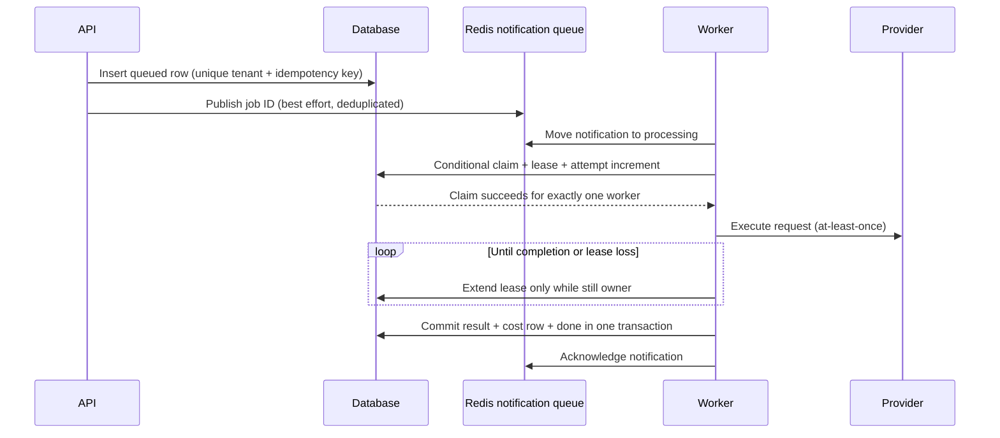

# Async job delivery and recovery

## State and ownership

```text
queued --atomic database claim--> running --lease-owned commit--> done
   ^                                  |
   |                                  +--retryable failure--> queued (available_at)
   |                                  +--terminal failure / retry limit--> dlq
   +------------------- operator replay of dlq (same job and idempotency key)
```

`attempts` remains the API-compatible attempt count; `attempt_count` mirrors it
for explicit operational inspection. `lease_owner` and `lease_expires_at` are
persisted with every claim. `available_at` makes retry delay durable, and
`replay_count` records DLQ replays without changing the job ID or idempotency
key.

## Database and Redis responsibilities

The database is the source of truth for job payload, state, attempt limits,
lease ownership, retry availability, result, and completion cost row. A claim
is a single conditional `UPDATE`: only a due queued row or an expired running
row below its retry limit can be claimed. SQLite serializes the conditional
write; PostgreSQL uses its row lock and rechecks the update predicate after
waiting. Competing workers cannot both update the same eligible state.

Redis lists, processing entries, leases, delayed retry entries, and DLQ hashes
are delivery/notification aids. Redis publication is deduplicated atomically.
Workers periodically query due database rows and republish missing
notifications. A Redis outage may delay delivery until a live worker can reach
the database; process memory is only a temporary notification fallback and is
not treated as durable state.

## Normal execution



## Crash recovery

```mermaid
sequenceDiagram
    participant W1 as Worker A
    participant DB as Database
    participant R as Redis
    participant W2 as Worker B
    W1->>R: Move job notification
    W1->>DB: Claim with lease A
    W1->>W1: Process exits before durable completion
    Note over DB: Lease A expires; state remains running
    W2->>DB: Reconcile expired lease into queued state
    W2->>R: Republish job ID if notification is missing
    W2->>DB: Conditional claim of due queued row
    DB-->>W2: Lease changes to B; attempt increments
    W1->>DB: Stale result commit with lease A
    DB-->>W1: Rejected; owner is B or lease expired
    W2->>DB: Persist result and mark done
```

## Idempotency, retries, and delivery guarantee

The database unique constraint is `(key_id, idempotency_key)`. Concurrent
requests that race at insert return the existing job after the database rejects
the duplicate. A repeated key continues to identify the same job after failure
or completion; an operator replay keeps that identity, resets the current
attempt counter, and increments `replay_count`.

Retryable failures use capped exponential backoff with jitter and persist the
next eligible time in `available_at` before updating Redis. At the retry limit,
the row transitions to `dlq`. Result persistence and the cost record share a
database transaction, and completion is conditional on an unexpired owned
lease.

This provides **at-least-once execution**, not exactly-once provider calls. If
an upstream provider completes a request and the worker crashes before the
result transaction commits, recovery may call the provider again. The database
prevents duplicate job completion and stale result overwrites, but cannot roll
back or deduplicate an external provider side effect.

## Operations and limitations

- Start the application worker normally; startup reconciliation republishes
  due jobs, and the worker repeats reconciliation every few seconds.
- If Redis is lost, restore Redis or restart a worker. Due jobs remain in the
  database and are rediscovered; Redis queue contents can be rebuilt from DB
  state.
- Inspect `/v1/jobs/{job_id}` with the owning API key/session or admin token;
  inspect and replay DLQ rows with the admin-protected `/v1/dlq` endpoints.
- Schema additions are applied by `init_jobs_db()` at application startup.
  Back up the database before upgrading. PostgreSQL startup also removes a
  legacy global idempotency constraint/index while preserving tenant-scoped
  uniqueness.
- Provider execution can repeat after lease expiry or process failure. Keep
  provider operations safe for retries where possible.
- PostgreSQL locking and transaction behavior must be exercised by the
  dedicated PostgreSQL CI job; SQLite and PostgreSQL do not share identical
  locking semantics.
