# Circuit breaker coordination

## State model

Breakers are scoped to a provider/model pair. `models.json` configures the default
failure threshold (5), recovery timeout (60 seconds), probe lease (30 seconds),
and whether HTTP 429 responses count as provider failures. Provider-specific
values can be added under `circuit_breakers.providers`.

```mermaid
stateDiagram-v2
    [*] --> CLOSED
    CLOSED --> OPEN: consecutive classified failures reach threshold
    OPEN --> HALF_OPEN: recovery timeout elapsed; atomic probe lease acquired
    HALF_OPEN --> CLOSED: current probe succeeds before lease expiry
    HALF_OPEN --> OPEN: current probe fails before lease expiry
    HALF_OPEN --> HALF_OPEN: lease expires; a new fenced probe is acquired
```



Provider attempts that see OPEN or an active HALF_OPEN lease are skipped and
continue through the configured static fallback chain. Each fallback model has
its own state and a successful fallback does not close the primary breaker.
Timeouts, network errors, and 5xx responses count as provider failures. Client
errors and cancellation do not; 429 counting is configurable while retry and
fallback behavior remains unchanged.

## Redis schema and atomicity

Redis hashes use `llm-gateway:circuit:<sha256(provider:model)>`. A hash stores
state, consecutive failures, version, thresholds, transition/open timestamps,
probe owner and expiry, and aggregate request/success/failure counters. Lua
scripts use Redis `TIME` and atomically acquire permits or apply outcomes. Every
permit carries the state version; HALF_OPEN completion also checks the owner
token and unexpired lease. Versions fence stale request outcomes. Probe tokens
are random and are never written to application logs. The key TTL is at least
24 hours and is refreshed on acquisition and accepted outcome updates, longer
than the configured cooldown. A crashed probe is reclaimed by its lease
timestamp even while its Redis hash remains present.

```mermaid
sequenceDiagram
    participant W1 as Worker 1
    participant R as Redis
    participant W2 as Worker 2
    W1->>R: Lua acquire (provider:model)
    R-->>W1: HALF_OPEN permit, version N, lease
    W2->>R: Lua acquire (provider:model)
    R-->>W2: reject, probe already owned
    W1->>R: Lua complete (version N, owner token)
    R-->>W1: transition to CLOSED or OPEN; version N+1
```

## Redis outage policy

When Redis operations fail, the breaker logs the coordination failure and uses
its process-local state under an asyncio lock. This keeps a Redis outage from
disabling every provider, but HALF_OPEN exclusivity and state consistency are
then guaranteed only inside each process. The coordination degraded gauge and
Redis failure counter expose the loss of distributed guarantees. After Redis
recovers, subsequent requests use shared Redis state again. If Redis restarts
without persistence and loses keys, breakers initialize CLOSED; deployments
that require breaker state to survive Redis loss must configure Redis
persistence/HA accordingly.

Application startup does not reset shared circuit keys. Admin reset and trip
operations are propagated to all known model breaker domains. Metrics include
one-hot circuit state, transitions, classified failures, probe outcomes,
rejections, Redis coordination failures, degraded coordination, and recovery
duration. Prometheus labels contain provider/model names, never request IDs or
tenant data.

## Verification

`tests/test_circuit_breakers.py` covers deterministic local probe exclusivity,
stale outcome fencing, and classification. Its Redis integration test uses two
independent breaker instances sharing Redis, races probe acquisition, expires a
lease using Redis server time, and rejects the stale owner. CI runs it against
the Redis service. Without `CIRCUIT_TEST_REDIS_URL` or `REDIS_URL`, that
distributed test skips; local-only tests do not establish cross-instance
correctness.
