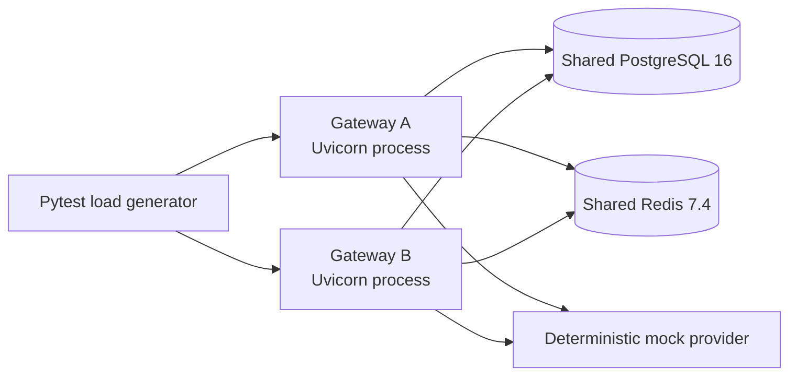

# Multi-instance reliability verification

## Test topology



`docker-compose.multi-instance.yml` starts disposable PostgreSQL and Redis services and a verifier container. The verifier starts two independent Uvicorn child processes with distinct PIDs and sends requests to them over HTTP. Neither gateway process shares application memory with the other. No provider API keys or external inference endpoints are used. PostgreSQL and Redis have no persistent volumes; removing the Compose stack removes all test state.

CI runs this as Stage F, separately from SQLite and the existing single-service integration stages. The verifier runs the suite with `GATEWAY_REQUIRE_MULTI_INSTANCE_TESTS=1`; direct ordinary pytest runs skip it unless explicitly opted in.

## Guarantees and boundaries

| Mechanism | Authority / coordination | Multi-instance behavior | Failure boundary |
|---|---|---|---|
| Daily budgets | PostgreSQL `budget_accounts` and `budget_reservations`; conditional atomic account update in `app/cost.py` | Reservation transactions serialize against the shared account; settlement/release are tenant scoped and conditional | Reservation expiry is the recovery mechanism after a process crash. A request may consume more than its estimate if provider usage exceeds the reserved estimate. |
| Rate limits | Redis token bucket Lua script in `app/security.py` | One atomic bucket per API key across gateway processes; CI checks combined quota and `Retry-After` | With `RATE_LIMIT_FAIL_MODE=closed`, requests fail closed while Redis is unavailable. Local fallback is process-local only when fail-open is configured. |
| Circuit breakers | Redis Lua state and versioned probe leases in `app/reliability.py` | Provider/model state and half-open permits are shared; tests observe one probe across both processes and reclaim a probe after killing its owner | Redis outage activates process-local degraded breaker state and loses distributed coordination until recovery. Provider-admin breakers remain separate from model breakers. |
| Async jobs | PostgreSQL `async_jobs` row, conditional lease claim and lease-checked finalization in `app/jobs.py`; Redis is notification/queue acceleration | Independent workers claim shared jobs; idempotency is tenant scoped; a killed worker's expired DB lease can be reclaimed by the survivor | Execution is at least once: a provider call can have happened before a crash even if its result was not committed. Exactly-once external inference is not guaranteed. |
| Global/provider concurrency and request coalescing | Process-local counters, locks, pools and futures in `app/reliability.py` / `app.cost.py` | Each gateway enforces its own limits; aggregate capacity can scale with instance count | These are not distributed semaphores. This stage reports observed summed local in-flight gauges; it does not claim a global cap. |
| Response cache | Redis when reachable; bounded process-local fallback in `app/cost.py` | Shared Redis cache in normal mode | Local fallback is per process and does not guarantee cross-instance cache hits. |
| Traffic/SSE broadcast | In-memory broadcaster in `app/reliability.py` | Per-process subscribers only | Events are not shared between instances. |

## Scenarios exercised

Stage F tests use real HTTP requests to both gateway processes and shared service state for:

- Simultaneous $6 budget reservations from separate gateway processes, repeated three times, verifying at most one reservation is admitted against a $10 account and inspecting the resulting shared account row.
- A single API key's five-request token bucket shared by both gateways; excess requests must return HTTP 429 with `Retry-After`.
- Shared provider-admin breaker visibility and one-winner half-open model probe coordination.
- Killing a gateway while it owns a Redis half-open probe lease, then verifying the surviving gateway reclaims the expired permit.
- Concurrent tenant-scoped idempotent job enqueueing, independent worker claims, and at-least-once job recovery after killing a worker process with a running job lease.
- A temporary Redis `CLIENT PAUSE` under fail-closed rate-limit policy followed by retry/recovery.
- 10, 50 and 100 concurrent chat requests. Pytest logs emit actual request counts, statuses, throughput, response latency percentiles and the maximum summed in-flight gauge sampled from the two processes. Sampling occurs periodically and can miss a short-lived peak; measurements are environment-specific, not performance targets.

The tests assert consistency and status semantics, not a throughput threshold. They do not model network partitions between production regions, failover of a managed Redis/PostgreSQL service, or exactly-once provider execution. PostgreSQL and Redis behavior is demonstrated only when Stage F completes successfully; no runtime measurements are recorded in this repository before that CI run.

## Run locally

```bash
docker compose -f docker-compose.multi-instance.yml up --build --abort-on-container-exit --exit-code-from verifier
docker compose -f docker-compose.multi-instance.yml down --volumes --remove-orphans
```

The GitHub Actions `multi-instance` job has a 25-minute timeout and always removes the disposable Compose services. Its output lines prefixed `MULTI_INSTANCE_` contain the observed process IDs, status counts, crash-recovery evidence and load measurements.
